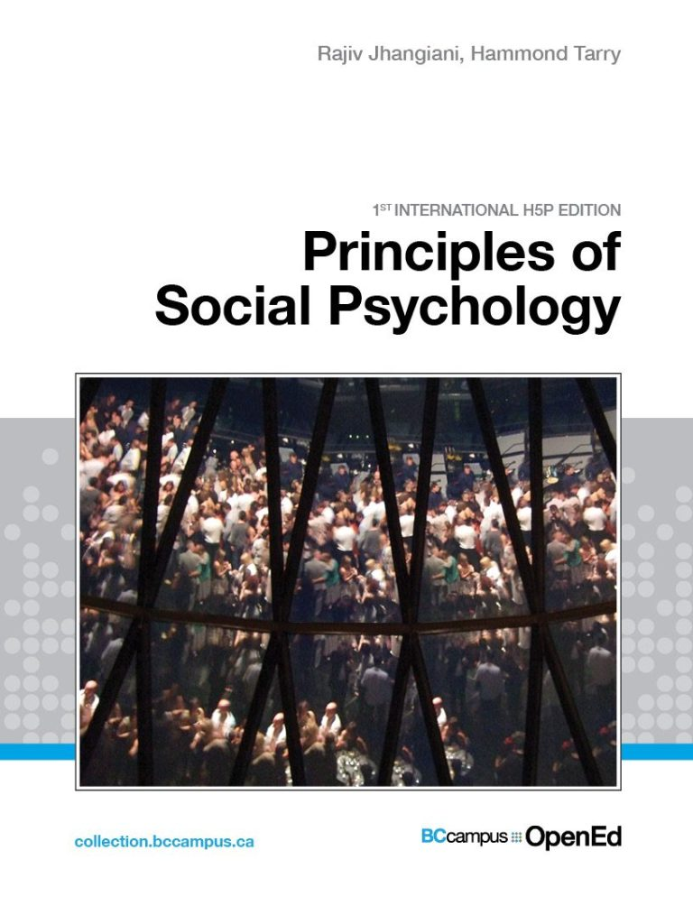

# Principles of Social Psychology - 1st International H5P Edition

Dr. Rajiv Jhangiani and Dr. Hammond Tarry

[CC BY-NC-SA 4.0](https://creativecommons.org/licenses/by-nc-sa/4.0/ ":class=navpill")

[Start Reading](section-1/accessibility-statement.md ":class=button :class=primary")

> [!IMPORTANT]
> **Principles of Social Psychology - 1st International H5P Edition – Imported from Pressbooks**
>
>
> **Authors:** Dr. Rajiv Jhangiani and Dr. Hammond Tarry | **License:** CC BY-NC-SA 4.0 | **72 pages**
>
> [View original on Pressbooks](https://opentextbc.ca/socialpsychology/)
>
>

The first international edition of this textbook provides students with an introduction to the basic concepts and principles of social psychology from an interactionist perspective. The presentation of classic studies and theories are balanced with insights from cutting-edge, contemporary research. An emphasis on real world examples and applications is intended to guide students to critically analyze their situations and social interactions in order to put their knowledge to effective use. In 2022, 25 interactive H5P activities were added throughout the book.

## [Front Matter](section-1/accessibility-statement.md) <!-- {docsify-ignore} -->

Accessibility, about, preface, and acknowledgements.

## [Chapter 1. Introducing Social Psychology](section-2/README.md) <!-- {docsify-ignore} -->

## [Chapter 2. Social Cognition](section-3/README.md) <!-- {docsify-ignore} -->

## [Chapter 3. The Self](section-4/README.md) <!-- {docsify-ignore} -->

## [Chapter 4. Attitudes, Behavior, and Persuasion](section-5/README.md) <!-- {docsify-ignore} -->

## [Chapter 5. Perceiving Others](section-6/README.md) <!-- {docsify-ignore} -->

## [Chapter 6. Influencing and Conforming](section-7/README.md) <!-- {docsify-ignore} -->

## [Chapter 7. Liking and Loving](section-8/README.md) <!-- {docsify-ignore} -->

## [Chapter 8. Helping and Altruism](section-9/README.md) <!-- {docsify-ignore} -->

## [Chapter 9. Aggression](section-10/README.md) <!-- {docsify-ignore} -->

## [Chapter 10. Working Groups: Performance and Decision Making](section-11/README.md) <!-- {docsify-ignore} -->

## [Chapter 11. Stereotypes, Prejudice, and Discrimination](section-12/README.md) <!-- {docsify-ignore} -->

## [Chapter 12. Competition and Cooperation in Our Social Worlds](section-13/README.md) <!-- {docsify-ignore} -->

## [Back Matter](section-14/about-the-authors.md) <!-- {docsify-ignore} -->

Appendices, bibliography, and versioning history.

## [Glossary](section-15/README.md) <!-- {docsify-ignore} -->

Terms used in this book.

**[Start Reading →](section-1/accessibility-statement.md)**

Principles of Social Psychology - 1st International H5P Edition by Dr. Rajiv Jhangiani and Dr. Hammond Tarry © 2022 is licensed under <a href="https://creativecommons.org/licenses/by-nc-sa/4.0/">CC BY-NC-SA 4.0</a>.

<!-- Hides the sidebar on this page -->

